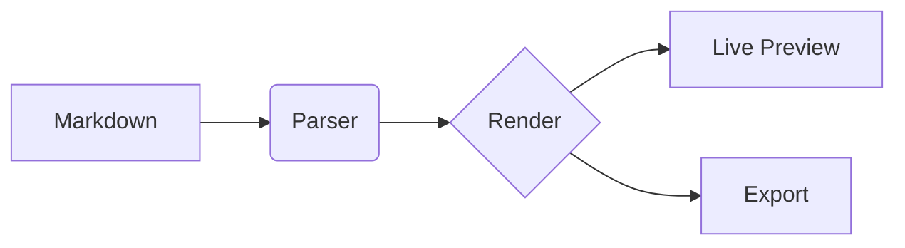

# Heading 1

## Heading 2 with *emphasis*

A paragraph with **strong**, *italic*, ~~strike~~, `inline code`, ==highlight==, H~2~O, x^2^, and a [link](https://example.com).
Also an inline formula $E = mc^2$ and a footnote reference[^1].

### Heading 3

> A blockquote line.
> A second line in the quote.

> [!NOTE]
> GitHub-style alert block rendered as `md-alert`.

- unordered item
- another item

1. ordered item
2. second item

- [ ] open task
- [x] done task

| Column A | Column B | Column C |
| -------- | :------: | -------: |
| left     | center   |    right |
| 1        | 2        |        3 |

```javascript
function greet(name) {
  // comment
  return `hello ${name}`;
}
```

```python
def fib(n):
    return n if n < 2 else fib(n - 1) + fib(n - 2)
```

$$
\int_0^\infty e^{-x^2}\,dx = \frac{\sqrt{\pi}}{2}
$$



---

[^1]: The footnote definition text.
